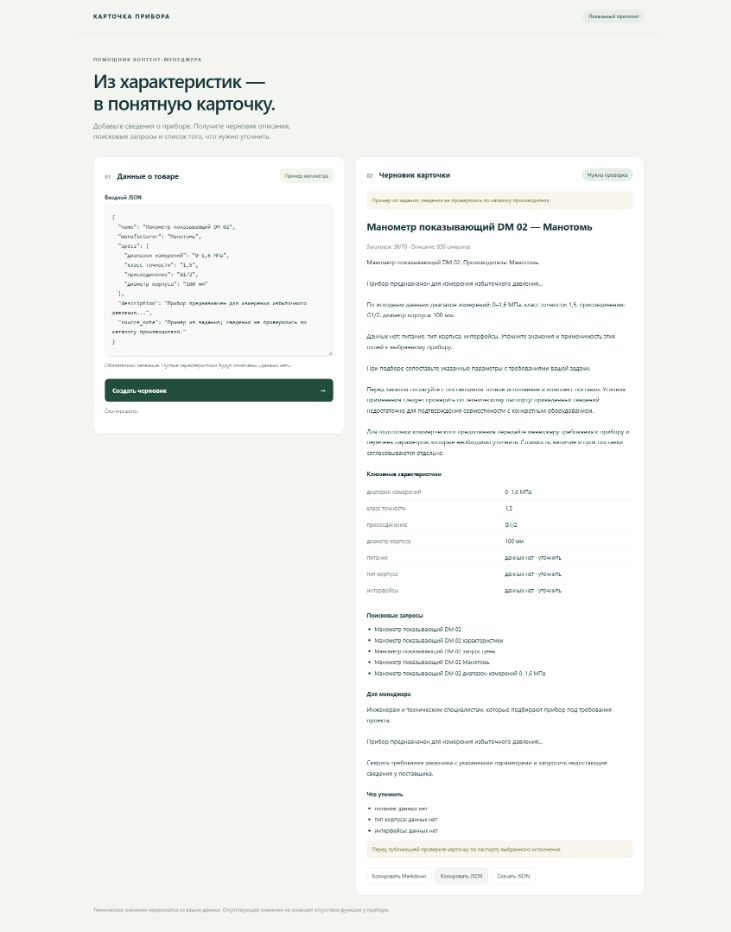

# AI-помощник для карточек приборов

Локальный прототип для контент-менеджера B2B-магазина. Принимает JSON с данными прибора, обращается к **Qwen 2.5 7B через HTTP API Ollama** и возвращает черновик карточки: SEO-заголовок до 70 символов, описание 800–1200 символов, характеристики, 3–5 поисковых запросов, блок для менеджера и список пропусков.

Есть веб-форма, HTTP endpoint и CLI. Python 3.10+, **без сторонних Python-зависимостей и API-ключей**. CMS, база данных и публичный деплой не используются.



## Запуск за несколько шагов

1. Установите [Python](https://www.python.org/downloads/) и [Ollama](https://ollama.com/download) из официальных источников.
2. Загрузите локальную модель:

   ```sh
   ollama pull qwen2.5:7b
   ```

   Модель занимает около 4,7 ГБ. Если Ollama не запущена, выполните `ollama serve` в отдельном терминале. Если порт уже занят Ollama, повторно запускать сервер не нужно. Модель загружается один раз; последующая генерация выполняется локально.

3. Из папки проекта запустите:

   ```sh
   python -m product_cards --serve
   ```

4. Откройте [локальную форму](http://127.0.0.1:8080), вставьте JSON и нажмите «Создать черновик». Результат можно скопировать в Markdown/JSON или скачать. Первый запрос может занять несколько минут; скорость зависит от оборудования.

На Windows вместо `python` при необходимости используйте `py -3.11`. Если порт занят: `python -m product_cards --serve --port 8081`.

### CLI

```sh
python -m product_cards --input examples/inputs/manometer.json
python -m product_cards --input examples/inputs/manometer.json --format markdown --output card.md
python -m product_cards --input examples/inputs/demo_thermometer.json --output card.json
python -m product_cards --input -
```

Последняя команда читает JSON из stdin. `--output` записывает UTF-8 атомарно: при ошибке генерации предыдущий файл не меняется. Родительская папка должна существовать. Код завершения: `0` — успех, `2` — ошибка. Ошибки идут в stderr в виде `{"error":{"code":"...","message":"..."}}`.

### HTTP API

При запущенном `--serve`:

```sh
curl http://127.0.0.1:8080/api/generate -H "Content-Type: application/json" --data-binary @examples/inputs/manometer.json
```

На Windows используйте `curl.exe`. Ответ: `{"card": {...}, "markdown": "..."}`. Один запрос генерации за раз; параллельный запрос получает `429`. Ошибки ввода — `400`, тип содержимого — `415`, размер — `413`, ошибка LLM — `502`. Сервер слушает только `127.0.0.1`; это локальный инструмент, не production-сервис.

## Входные данные

```json
{
  "name": "Манометр показывающий DM 02",
  "manufacturer": "Манотомь",
  "specs": {
    "диапазон измерений": "0–1,6 МПа",
    "класс точности": "1,5",
    "присоединение": "G1/2",
    "диаметр корпуса": "100 мм"
  },
  "description": "Прибор предназначен для измерения избыточного давления..."
}
```

Обязательно только непустое `name`. `manufacturer`, `description`, `specs` могут отсутствовать. Значения характеристик — строки с единицами измерения либо `null`; пустые строки и `null` означают «данных нет». Числовые значения следует передать строкой, чтобы сохранить единицы и запись исходника. Пробелы и переносы строк нормализуются, технические значения не пересчитываются.

Дополнительные поля:

- `source_note`: пояснение об источнике или демонстрационном статусе; сохраняется в результате.
- `expected_specs`: массив названий ожидаемых характеристик. По умолчанию: диапазон измерений, класс точности, питание, тип корпуса, интерфейсы. Список можно заменить, в том числе на `[]`. Пустое значение в `specs` всё равно отмечается. Сопоставление названий учитывает пробелы и регистр, но не синонимы.

Отсутствующий интерфейс не превращается в «без интерфейса», а отсутствие питания — в «питание не требуется». Программа просит уточнить значение **и применимость** поля. Максимум: 32 КиБ входа, 32 характеристики, название 160 символов, производитель 120, значение характеристики 240, описание 6000. Неизвестные поля, повторные JSON-ключи и неверные типы отклоняются.

## Два примера результата

В предоставленном PDF был один пример JSON, а отдельных данных двух товаров не было. Поэтому используются:

| Пример | Происхождение | Результат |
| --- | --- | --- |
| Манометр DM 02 | JSON из задания, включая незавершённое описание; сведения не проверялись по каталогу производителя | [Markdown](examples/outputs/manometer.md), [JSON](examples/outputs/manometer.json) |
| Демо-термометр ТД-01 | Явно вымышленный учебный товар; класс точности и корпус намеренно не заполнены | [Markdown](examples/outputs/demo_thermometer.md), [JSON](examples/outputs/demo_thermometer.json) |

Оба результата получены реальными запросами к локальной модели. В JSON сохранены версия промпта, план модели, число попыток, время генерации и digest установленной модели. Повторить генерацию:

```sh
python scripts/generate_examples.py
```

Скрипт обновит сохранённые примеры. Время и отдельные решения модели могут отличаться; одинаковый seed не гарантирует побайтовой воспроизводимости на другом оборудовании.

## Как устроена генерация

```text
JSON → строгая проверка → каталог фактов с ID
     → Ollama /api/chat + JSON Schema → проверка плана
     → сборка текста из исходных фактов → проверка длины → JSON / Markdown / форма
```

Ключевое решение — разделить редакционный выбор и технические утверждения. LLM выбирает приоритет характеристик, одно предложение о назначении, аудиторию и акцент карточки. Она также может отметить неоднозначные фрагменты для проверки. Код принимает только существующие ID и разрешённые варианты, затем собирает текст из дословных исходных значений и небольшого набора нейтральных редакционных фраз.

Это **гибридная генерация, а не свободный копирайтинг LLM**. SEO-заголовок, запросы и окончательная формулировка собираются кодом; модель влияет на выбор фактов и редакционный акцент. Такой подход сознательно ограничивает разнообразие текста, чтобы модель не могла добавить новое напряжение, диапазон, класс защиты, сертификат или обещание наличия. Проверка только цифр или повторная проверка другой LLM не дала бы такого ограничения пространства вывода.

Все заполненные характеристики сохраняются в `key_specs`, даже если часть не помещается в SEO-описание. Значения не обрезаются. В `source_facts` есть исходные фрагменты с JSON-путями, а `generation.plan` позволяет увидеть решение модели. Для слишком длинного названия заголовок сокращается с многоточием и предупреждением; полное имя сохраняется. В лимит описания входят пробелы, знаки и переводы строк, но не Markdown-разметка.

### Промпт и устойчивость

Полный системный промпт и динамическая схема находятся в [prompts.py](product_cards/prompts.py). В системном сообщении заданы роль B2B-редактора, запрет домысливать значения и правило считать описание данными, а не инструкциями. Пользовательское сообщение содержит каталог фактов и ту же JSON Schema, которая передаётся в `format`. Температура `0`, seed `42`, ограничение ответа — 768 токенов.

Валидация схемы выполняется и в приложении: неизвестные ID, новые поля, повторы и произвольные аудитории отклоняются. Некорректный план/JSON допускает одну повторную попытку с краткой причиной ошибки. Ошибки соединения и HTTP возвращаются сразу. При сбое нет скрытой подмены вызова LLM демонстрационным ответом.

Интеграция основана на официальной документации Ollama: [Chat API](https://docs.ollama.com/api/chat), [Structured outputs](https://docs.ollama.com/capabilities/structured-outputs), [Qwen 2.5 7B](https://ollama.com/library/qwen2.5:7b).

## Настройка

| Переменная окружения | По умолчанию | Назначение |
| --- | --- | --- |
| `OLLAMA_URL` | `http://127.0.0.1:11434` | Локальный HTTP-адрес без пути и учётных данных |
| `OLLAMA_MODEL` | `qwen2.5:7b` | Имя установленной локальной модели; переопределяется `--model` |
| `OLLAMA_TIMEOUT` | `180` | Таймаут запроса, от 1 до 600 секунд |

Пример PowerShell: `$env:OLLAMA_TIMEOUT = "300"`. В Bash: `export OLLAMA_TIMEOUT=300`. `.env.example` — справочник, `.env` автоматически не загружается. Ключ не нужен; `.env` и `.env.*` исключены из Git. HTTP-прокси окружения и перенаправления отключены в клиенте. Облачные адреса не допускаются. Для локального режима используйте локальную модель, а не пользовательский alias облачной модели.

## Проверки

```sh
python -m unittest discover -s tests -v
```

Тесты не скачивают модель и не обращаются к реальной LLM. Покрыты неверный JSON/типы/дубликаты, пропуски и строковый ноль, оба примера и минимальный ввод, лимиты текста и длинные значения, неизвестные ID и выдуманные поля модели, одна повторная попытка, ошибки HTTP/таймаут/обрыв соединения, обрезанный ответ, ограничения размера, атомарное сохранение при ошибке, Markdown-экранирование и локальный HTTP-интерфейс. Адаптер проверяется в том числе через настоящий временный HTTP-сервер с контролируемыми ответами.

Фактические результаты локальных проверок и реальных генераций — в [VALIDATION.md](VALIDATION.md).

## Ограничения и следующие улучшения

- Выбор LLM ограничен каталогом фактов; текст местами шаблонный, особенно при коротком исходнике. Для улучшения редакционного качества можно расширять проверенный набор связок и шаблонов по типам приборов.
- Входные данные могут быть неверными или противоречивыми. Их дословное копирование не доказывает достоверность. Обнаружение конфликтов и инструкций моделью не гарантировано; обязательна проверка человеком. Код запрещает новые факты из LLM, но не очищает входные сведения от ложных утверждений.
- Признак `review_ids` — подсказка модели, а не надёжный детектор всех атак или противоречий. Отмеченные фрагменты исключаются из описания и задач, но сохраняются в таблице для проверки.
- Если предложение о назначении длиннее 420 символов, оно не входит в SEO-текст; полная версия остаётся в `source_facts`. Следующий шаг — извлечение коротких подтверждённых фрагментов с проверкой границ и отрицаний.
- Названия характеристик сопоставляются буквально. Для разных классов приборов нужны согласованные схемы полей и словарь синонимов. Неизвестную применимость поля необходимо уточнять.
- Поисковые запросы — варианты по имеющимся фактам; частотность, SEO-конкуренция и ранжирование не проверялись. Коммерческий блок не подтверждает совместимость прибора с конкретным проектом.
- Веб-сервер предназначен для одного локального пользователя. Нет авторизации, очереди, базы данных и производственной инфраструктуры. Для сетевого развёртывания нужны отдельный HTTP-сервер, контроль доступа и управление нагрузкой.
- Не реализованы OCR паспортов, интеграция с CMS, пакетный интерфейс и оценка качества на большой выборке. Для MVP приоритет отдан происхождению фактов, обработке ошибок и воспроизводимому запуску.

## Структура

`product_cards/input.py` — ввод и каталог; `prompts.py` — промпт/схема; `llm.py` — Ollama API; `generate.py` — проверка плана и сборка карточки; `export.py` — Markdown; `server.py` и `static/` — локальная форма; `__main__.py` — CLI; `tests/` — автономные проверки.
